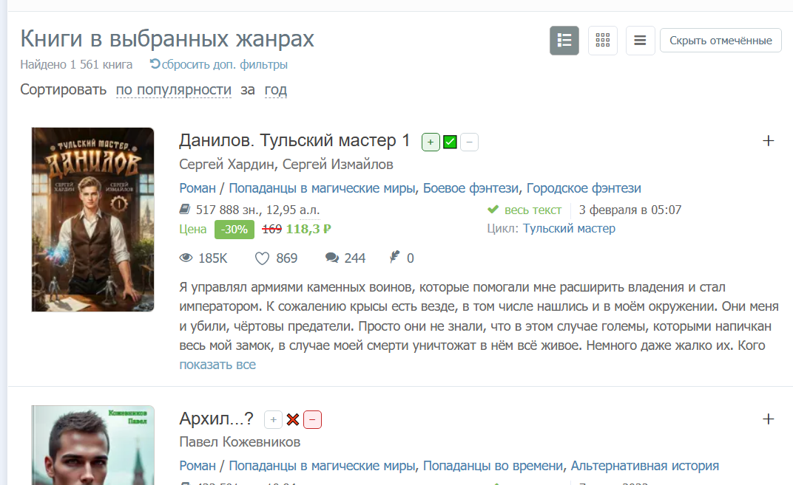

# Author.Today — отметки книг

> Расширение для Chrome/Brave/Edge: отметки ✅/❌ прямо на страницах author.today. Без регистрации. Синхронизация между устройствами по кодовой фразе.

   [](DEVELOPMENT.md) [](https://github.com/Rocaccel/author-today-read/issues) [](https://github.com/Rocaccel/author-today-read/discussions) [](LICENSE)

| 📝 Отметки книг             | 💾 Локальное хранение данных |
|:--------------------------- |:---------------------------- |
| 🔄 Облачная синхронизация   | 🛡️ Шифрование AES-GCM         |
| 📤 Экспорт/импорт JSON      | 🌓 Поддержка тёмной темы     |
| 🔓 Работает без регистрации | 🌐 Chrome/Brave/Edge         |

## Содержание

- [Кратко о расширении](#кратко-о-расширении)
- [Установка](#установка)
  - [Вариант А: Запакованный файл (.crx)](#вариант-а-запакованный-файл-crx---рекомендуется)
  - [Вариант Б: Готовый архив](#вариант-б-готовый-архив---всегда-работает)
  - [После установки: как включить синхронизацию](#после-установки-как-включить-синхронизацию)
- [Как это работает на сайте](#как-это-работает-на-сайте)
- [Как отметить книгу](#как-отметить-книгу)
- [Синхронизация между устройствами](#синхронизация-между-устройствами)
  - [Кодовая фраза: вход и хранение](#кодовая-фраза-вход-и-хранение)
  - [Смена кодовой фразы (v0.2.6)](#смена-кодовой-фразы-v026)
  - [Список устройств (v0.2.6)](#список-устройств-v026)
  - [Бэкап и восстановление (JSON)](#бэкап-и-восстановление-json)
  - [Удаление всех данных (v0.2.6)](#удаление-всех-данных-v026)
- [Часто задаваемые вопросы (FAQ)](#часто-задаваемые-вопросы-faq)
- [Для разработчиков](#для-разработчиков)
- [История версий (Что нового)](#история-версий-что-нового)
- [Лицензия](#лицензия)

## Кратко о расширении

Это Chrome/Brave/Edge-расширение добавляет кнопки **[+]** и **[−]** с индикатором **✅ / ❌ / пусто** рядом с названием книги в списках, таблицах поиска, каталогах и на страницах книг author.today.

* **Работает без регистрации:** Ваши отметки хранятся только в браузере.
* **Приватность:** Author.Today не видит ваших отметок.
* **Синхронизация:** Отметки синхронизируются между вашими устройствами по уникальной кодовой фразе.
* **Безопасность:** Все облачные данные зашифрованы.
* **Офлайн-режим:** Можно отмечать книги без подключения к интернету.

## Установка

Расширение работает в браузерах на базе Chromium (Google Chrome, Brave, Microsoft Edge, Opera и др.).

### Вариант А: Запакованный файл (.crx) — рекомендуется

1. **Скачайте** последний `author-today-read-0.2.6.crx` со страницы [Releases](https://github.com/Rocaccel/author-today-read/releases).
2. Откройте страницу управления расширениями: введите `chrome://extensions` в адресной строке.
3. Включите **Режим разработчика** (переключатель в правом верхнем углу страницы).
4. **Перетащите** скачанный файл `.crx` прямо в окно `chrome://extensions`. Появится запрос — подтвердите установку.

_Если браузер блокирует установку `.crx` (появляется сообщение `«повреждённый файл»` или `«заблокировано»`) — используйте Вариант Б._

### Вариант Б: Готовый архив — всегда работает

1. **Скачайте** последний `author-today-read-0.2.6.zip` со страницы [Releases](https://github.com/Rocaccel/author-today-read/releases).
2. **Распакуйте** скачанный архив в любую удобную папку на вашем компьютере.
3. Откройте страницу управления расширениями: `chrome://extensions`.
4. Включите **Режим разработчика** (переключатель в правом верхнем углу страницы).
5. Нажмите кнопку **«Загрузить распакованное расширение»** и выберите папку, куда вы распаковали архив.

_Важно: не удаляйте распакованную папку после установки, иначе расширение перестанет работать._

### После установки: как включить синхронизацию

Чтобы использовать облачную синхронизацию:

1. Нажмите на значок "Расширения" (🧩) в правом верхнем углу браузера.
2. В появившемся списке найдите "Author.Today - отметки книг".
3. Нажмите на три точки (⋮) справа от названия расширения, чтобы открыть меню.
4. Выберите пункт **«Параметры»**.
5. На открывшейся вкладке следуйте инструкциям для [входа по кодовой фразе](#кодовая-фраза-вход-и-хранение).

## Как это работает на сайте

Расширение добавляет кнопки **[+]** и **[−]** и индикатор **✅ / ❌ / пусто** рядом с названием книги в следующих местах:

| Страница                            | Вид «список (строки)» | Вид «таблица» | Вид «плитка» |
|:----------------------------------- |:---------------------:|:-------------:|:------------:|
| Каталог, жанры, скидки…             | ✅                     | ✅             | —            |
| Результаты поиска                   | ✅                     | ✅             | —            |
| Страница книги                      | панель в заголовке    | —             | —            |
| Остальные страницы, главная, плитка | —                     | —             | —            |

* **Страница книги:** Панель интегрируется внутри заголовка `h1.book-title` сразу после текста названия.
* **Единая отметка:** Отметка, поставленная в одном месте (например, в списке), будет видна везде на сайте (на странице книги, в других вкладках).



На скриншоте: кнопки **[+]** и **[−]** с индикатором состояния **✅ / ❌ / пусто** рядом с названием книги. Кликните на кнопку, чтобы отметить книгу — отметка сохраняется локально и синхронизируется при наличии кодовой фразы.

* **Скрытие отмеченных:** В шапке списков и таблиц рядом с переключателем видов появляется кнопка **«Скрыть отмечённые»**. Она убирает из вида строки и карточки с ✅/❌. В плиточном виде (карточки `.bookcard`) кнопки нет, но функция скрытия все равно применяется.

## Как отметить книгу

* Нажмите **`+`**, чтобы поставить отметку `✅` («прочитано»). Повторное нажатие на эту же кнопку снимает отметку.
* Нажмите **`−`**, чтобы поставить отметку `❌` («пропущено/брошено»). Повторное нажатие на эту же кнопку снимает отметку.
* Если у книги уже есть одна отметка (например, `✅`), а вы нажимаете другую кнопку (например, `−`), то старая отметка **заменяется** на новую.
* Все отметки сохраняются мгновенно. Их состояние будет видно после перезагрузки страницы и в других открытых вкладках.
* Кнопка **«Скрыть отмечённые»** скрывает из поиска уже отмеченные книги.
* Статистика: количество прочитанных, пропущенных и всех отмеченных книг доступно в **Параметрах** расширения (раздел «Статистика»). Эта функция работает даже без настроенной синхронизации. Под счётчиками видно, на какое время данные («Данные на HH:MM»).

## Синхронизация между устройствами

Вы можете переносить и синхронизировать свои отметки между любыми вашими устройствами (настольный ПК, ноутбук, другой браузер) без необходимости регистрации или использования пароля Author.Today. Единственным ключом доступа является **кодовая фраза** (набор из примерно 15 слов).

* **Шифрование данных:** Ваши отметки хранятся в облаке в полностью зашифрованном виде. Без вашей кодовой фразы расшифровать и восстановить их невозможно.
* **Приватность:** Сайт author.today и любые третьи лица не имеют доступа к вашей кодовой фразе или содержимому ваших отметок.
* **Автоматическая работа:** Синхронизация происходит в фоновом режиме. Через несколько секунд после того, как вы отметите книгу, данные отправляются в облако. Если подключение к интернету временно отсутствует, расширение автоматически повторит попытку отправки, как только связь восстановится. Вы можете спокойно отмечать книги даже в офлайн-режиме.
* **Бэкап:** Помимо синхронизации, вы можете в любой момент выгрузить или загрузить свои отметки в виде JSON-файла.

### Кодовая фраза: вход и хранение

1. Откройте **Параметры** расширения (см. [«После установки: как включить синхронизацию»](#после-установки-как-включить-синхронизацию)).
2. В разделе синхронизации вы можете:
   * Или нажать **«Создать фразу»**: расширение сгенерирует для вас 15 случайных слов. **КРАЙНЕ ВАЖНО ЗАПИСАТЬ ЭТУ ФРАЗУ В БЕЗОПАСНОЕ МЕСТО** и подтвердить это соответствующим чекбоксом. Затем нажмите «Сохранить и войти».
   * Или ввести **свою собственную фразу**: она должна состоять из 12–30 слов.
3. На других ваших устройствах просто установите расширение и в его **Параметрах** введите **ту же самую кодовую фразу**. Отметки автоматически подтянутся, и дальнейшая синхронизация будет работать в обе стороны.

Если вкладка author.today уже открыта — после сохранения фразы она подтянет отметки **сразу**, отдельных действий не требуется.

**Что делать, если забыли кодовую фразу?**
Ваша кодовая фраза всегда доступна в **Параметрах** расширения, в блоке «Кодовая фраза». Вы можете использовать кнопки «Показать» (для отображения текста фразы) или «Копировать» (для копирования её в буфер обмена).

⚠️ **Потеря кодовой фразы означает потерю доступа к вашим облачным отметкам.** Сохраняйте её в надежном и доступном только вам месте. Фраза сохраняется только на ваших устройствах, и никто, кроме вас, её не знает и не сможет восстановить.

### Смена кодовой фразы (v0.2.6)

Если вы считаете, что кодовая фраза могла стать известна третьим лицам, её можно **сменить без потери отметок**:

1. Откройте **Параметры** расширения → блок «Кодовая фраза» → **«Сменить фразу»**.
2. Нажмите **«Сгенерировать»** (или введите свою фразу 12–30 слов) и обязательно **запишите её в безопасное место** — без неё доступ к облачным отметкам восстановить невозможно.
3. Подтвердите чекбоксом и нажмите **«Сменить и войти»**.

Что происходит при смене:

* **Все отметки перешифровываются новой фразой и переносятся на новый путь в облаке** (с учётом времени последнего изменения — более новые версии не теряются).
* **Старая база удаляется полностью** — доступ по старой фразе пропадает навсегда.
* Отметки не теряются. Если смена прервалась (нет сети и т.п.), ничего не меняется — просто повторите её.
* **Открытые вкладки author.today подтянут отметки сразу** после смены — не нужно ждать фокуса или перезагрузки страницы.

⚠️ **Сразу после смены введите новую фразу на всех остальных устройствах** (Параметры → «Сохранить и войти»). Устройства со старой фразой продолжат работать со старой базой и не увидят новых отметок.

Смена фразы доступна только при настроенной синхронизации (без конфига облака нет — удалять нечего).

### Список устройств (v0.2.6)

Пока синхронизация настроена, расширение помнит, с каких устройств идёт работа, и показывает их в **Параметрах** — блок **«Устройства»**:

1. Откройте **Параметры** расширения → блок **«Устройства»** (виден только при настроенной синхронизации и введённой фразе).
2. В списке — все устройства с вашей фразой: имя («Chrome · Windows» или ваше собственное), платформа, время последней активности. Текущее устройство помечено бейджем **«Это устройство»**.
3. Для **чужого** устройства доступны две кнопки:
   * **«Переименовать»** — задайте понятное имя («Рабочий ноутбук», «Домашний ПК»), имя сохраняется в облаке и видно на всех устройствах;
   * **«Удалить»** — после подтверждения устройство помечается удалённым.

Имена и платформы устройств хранятся в облаке **зашифрованными вашей кодовой фразой** (как и отметки): в консоли Firebase посторонний видит только шифротекст и таймстемпы, прочитать названия устройств без фразы невозможно.

Что происходит при удалении чужого устройства: при **следующей синхронизации** оно **тихо удаляет свои локальные данные и выходит из фразы** — «как после установки»: отметки в этом браузере стираются, кодовая фраза удаляется, вход по фразе нужно пройти заново. Никаких предупреждений на удалённом устройстве нет — это и есть цель: удалить данные удалённо, когда устройство потеряно или скомпрометировано.

Примечания:

* **Своё устройство удалить нельзя** (кнопок у своей строки нет) — сбросить себя можно только через «Удаление данных» (см. ниже). Это осознанное ограничение.
* Удалённое устройство **восстановить нельзя** — вход по той же фразе зарегистрирует его заново как новое.
* Для работы списка нужна актуальная **правила БД** с узлом `devices` (сниппет в [DEVELOPMENT.md](DEVELOPMENT.md)); со старыми правилами синхронизация отметок продолжает работать, а блок «Устройства» покажет подсказку про правила.

### Бэкап и восстановление (JSON)

Функция бэкапа позволяет гибко управлять вашими отметками через JSON-файлы:

1. Откройте **Параметры** расширения.
2. Перейдите в раздел **«Бэкап»**.
3. **«Экспорт JSON»**: Скачивает файл со всеми вашими текущими отметками. Дата и время экспорта включены в имя файла.
4. **«Импорт JSON»**: Позволяет загрузить ранее сохранённый JSON-файл. При импорте происходит интеллектуальное объединение данных: более новые локальные отметки не будут случайно затёрты, а данные из файла будут добавлены или обновлены с учётом времени последнего изменения. Для этой операции кодовая фраза не нужна.

### Удаление всех данных (v0.2.6)

Функция полного удаления — когда нужно стереть все отметки без возможности восстановления:

1. Откройте **Параметры** расширения → блок **«Удаление данных»** → **«Удалить все данные…»**.
2. Прочитайте предупреждение, установите чекбокс **«Я понимаю: данные удаляются безвозвратно»** и нажмите **«Удалить всё безвозвратно»**.

Что удаляется:

* **Отметки в облаке** (если настроена синхронизация) — ваш узел в базе удаляется целиком.
* **Отметки в этом браузере** — открытые вкладки author.today очищаются сразу, без перезагрузки; тумблер «Скрыть отмечённые» сбрасывается.
* **Кодовая фраза и статусы расширения** — статистика обнуляется, бэкап становится пустым; вход по фразе нужно будет пройти заново.

Если синхронизация не настроена (нет конфига) или фраза неизвестна — облако **не трогается** (удалить его нечем/нечем подтвердить доступ), но локальные данные и статусы будут удалены; результат сообщит об этом. Если облако недоступно (нет сети) — ничего не меняется, ошибка показывается в форме, операцию можно повторить.

⚠️ **На других устройствах с той же фразой выполните то же самое** — иначе их локальные отметки при следующей синхронизации снова уйдут в облако и восстановят удалённое.

Отметить книгу заново после удаления можно как обычно — расширение продолжит работать (сначала локально, вход по фразе — когда захотите).

## Часто задаваемые вопросы (FAQ)

**В: Работает ли расширение в Firefox?**
О: Нет, расширение разработано для браузеров на базе Chromium (Chrome, Brave, Edge и т.д.) и использует специфические API, недоступные в Firefox.

**В: Могу ли я пользоваться расширением без кодовой фразы?**
О: Да, все основные функции (отметки, скрытие, локальное хранение) будут работать. Просто не будет облачной синхронизации между устройствами.

**В: Где хранятся мои отметки?**
О: Ваши отметки хранятся в `localStorage` страницы author.today в вашем браузере. Для синхронизации они также в зашифрованном виде передаются в Firebase Realtime Database.

**В: Что такое «томбстоуны» в контексте синхронизации?**
О: Томбстоун (tombstone) — это специальная запись, которая помечает удалённую отметку. Это нужно для корректной синхронизации: если вы удалили отметку на одном устройстве, томбстоун сообщает другим устройствам, что эту отметку тоже нужно удалить, а не восстанавливать старую версию из облака. Томбстоуны автоматически удаляются из облака через 90 дней.

## Для разработчиков

* **[DEVELOPMENT.md](DEVELOPMENT.md)**: Здесь вы найдете подробную информацию о структуре проекта, запуске тестов и настройке синхронизации из исходников.
* **[AGENTS.md](AGENTS.md)**: Полная и актуальная спецификация проекта.

**Быстрый старт:**

```bash
# Установка зависимостей (только для тестов)
npm install

# Запуск автотестов
npm test

# Создание config.json для Firebase из .env
npm run config
```

## История версий (Что нового)

* **v0.2.6 (2026-10-16)**: Смена кодовой фразы без потери отметок: все записи перешифровываются и переносятся на новый путь в облаке, старая база удаляется. Новая кнопка «Сменить фразу» в Параметрах. Открытые вкладки подтягивают отметки сразу после входа и после смены фразы; строка свежести «Данные на HH:MM» в разделе «Статистика»; полное удаление всех данных (облако + браузер + фраза) — блок «Удаление данных» в Параметрах; блок **«Устройства»** в Параметрах: список устройств с вашей фразой, переименование и удаление чужого устройства — удалённое устройство при следующей синхронизации тихо стирает свои локальные данные и выходит из фразы. Имена и платформы устройств в облаке зашифрованы кодовой фразой — в консоли Firebase они не читаются.
* **v0.2.5 (2026-10-16)**: Добавлена кнопка «Скрыть отмечённые» в шапке списков и таблиц. Карточки в плиточном виде теперь также скрываются.
* **v0.2.4 (2026-09-28)**: Реализован полный цикл экспорта и импорта отметок в JSON-файл через страницу настроек.
* **v0.2.3 (2026-09-15)**: Добавлены иконки расширения для лучшего отображения в тулбаре браузера и на странице расширений.
* **v0.2.1 (2026-09-01)**: Улучшена система синхронизации: добавлены автоматические ретраи при сбоях сети и функция "сборки мусора" (GC) для автоматического удаления старых томбстоунов.

## Лицензия

Проект распространяется под лицензией [0BSD](https://opensource.org/licenses/0BSD) (BSD Zero Clause License). Полный текст лицензии доступен в файле [LICENSE](LICENSE).
